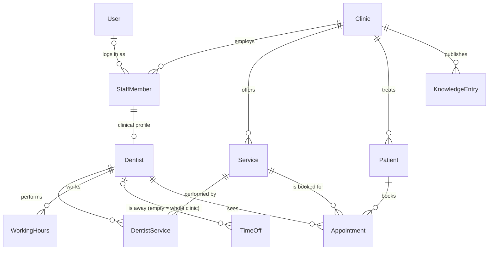

# Architecture

A reusable Dental Clinic SaaS demo. This document describes the system as it
is built today and the decisions behind it. Rules for working on it are in
`PROJECT_RULES.md`.

## 1. System overview

| Layer          | Technology               | Status                       |
| -------------- | ------------------------ | ---------------------------- |
| Backend, admin | Django 5.2 LTS (Python)  | Schema (Task 1); admin and booking engine (Task 2) |
| Database       | Supabase PostgreSQL      | Schema and migrations ready  |
| Frontend       | Next.js + TypeScript     | Later phase — not started    |
| AI assistant   | Ollama (local models)    | Later phase — not started    |

Django owns the database schema: all tables are created by Django migrations,
and Django connects to Supabase as a plain PostgreSQL client. Supabase's own
APIs (Data API, Auth, Storage) are not used.

## 2. Repository layout

```
.
├── ARCHITECTURE.md
├── PROJECT_RULES.md
└── backend/
    ├── manage.py
    ├── requirements.txt
    ├── .env.example          # placeholders only; real values in backend/.env
    ├── config/               # settings, URLs, WSGI/ASGI
    ├── apps/
    │   ├── core/             # abstract base models, tenant constraint, admin base
    │   ├── accounts/         # custom User model (admin logins)
    │   ├── clinics/          # Clinic — the tenant
    │   ├── catalog/          # Service — treatments offered
    │   ├── staff/            # StaffMember, Dentist, DentistService; access control
    │   ├── patients/         # Patient
    │   ├── scheduling/       # WorkingHours, TimeOff
    │   ├── appointments/     # Appointment; booking engine (booking.py)
    │   └── knowledge/        # KnowledgeEntry — curated content for the AI
    └── tests/                # database integrity tests (cross-app)
```

The future frontend will live in `frontend/`.

### App dependencies

Apps only depend downwards (`→` means "depends on"; every app also uses
`core`, which depends on nothing project-specific and refers to
`clinics.Clinic` by string only):

```
clinics      → core
catalog      → clinics
staff        → clinics, catalog, accounts
patients     → clinics
scheduling   → clinics, staff
appointments → clinics, staff, patients, catalog, scheduling
knowledge    → clinics
```

The graph applies to models and services. `admin.py` modules are the
presentation layer: they may import any app, and all of them use
`apps.staff.access` for clinic scoping (section 7).

## 3. Data model

All primary keys are `bigint` identities. All timestamps are `timestamptz`
stored in UTC. Every model except `User` and `Clinic` is clinic-scoped and has
`clinic_id`, `created_at` and `updated_at`.



| Table                      | Purpose                                     | Key rules enforced by PostgreSQL |
| -------------------------- | ------------------------------------------- | -------------------------------- |
| `accounts_user`            | Admin/staff login accounts                  | Django auth defaults |
| `clinics_clinic`           | Tenant: name, slug, contact, time zone, currency | unique `slug` |
| `catalog_service`          | Treatments, duration, optional price        | unique name per clinic; duration 5–480 min; price ≥ 0 |
| `staff_staffmember`        | People working at a clinic, role, optional login | valid role; a login linked once per clinic |
| `staff_dentist`            | Bookable clinical profile of a staff member | one profile per staff member; same clinic as staff member |
| `staff_dentistservice`     | Which dentist performs which service        | unique pair; both in the row's clinic |
| `scheduling_workinghours`  | Weekly recurring availability blocks        | weekday 0–6 (Mon–Sun); end > start; unique block start |
| `scheduling_timeoff`       | Absences; no dentist = clinic-wide closure  | end > start |
| `patients_patient`         | Patient contact data                        | — |
| `appointments_appointment` | Bookings                                    | end > start; valid status/source; **no overlaps**; patient, dentist, service all in the appointment's clinic |
| `knowledge_knowledgeentry` | Curated public content for the AI assistant | unique title per clinic + language; valid category |

Deletion policy: clinics, patients, dentists and services that are referenced
by appointments are protected (`PROTECT`); deactivate them with `is_active` /
`is_bookable` instead. Schedules, time off and dentist–service links are
deleted with their dentist.

## 4. Multi-clinic isolation

Every clinic-scoped row stores `clinic_id`. A plain foreign key cannot stop an
appointment of clinic A from referencing a dentist of clinic B, so each
relation between clinic-scoped models is a **composite foreign key**:

```sql
-- target side
UNIQUE (clinic_id, id)                                   -- e.g. on staff_dentist
-- referencing side
FOREIGN KEY (clinic_id, dentist_id) REFERENCES staff_dentist (clinic_id, id)
```

This is declared in Python with `apps.core.constraints.SameClinicConstraint`,
so Django's migration autodetector tracks it like any built-in constraint,
`manage.py check --database default` (also run before every test run)
verifies its prerequisites, and model validation (admin
forms) reports a field error instead of a database error. The composite key
also makes it impossible to move a record to another clinic while other rows
still reference it.

Adding a new clinic-scoped model:

1. Inherit `ClinicScopedModel`.
2. For each foreign key to another clinic-scoped model, add
   `SameClinicConstraint(field=..., name=...)`.
3. If other models will reference it, add
   `UniqueConstraint(fields=["clinic", "id"], name="<app>_<model>_clinic_key")`.
4. If a migration creates the key and a constraint referencing it, make sure
   the key comes first (see the comment in `staff/migrations/0001_initial.py`).

Tests in `tests/test_clinic_isolation.py` fail if steps 1–2 are forgotten;
the system check (error `core.E003`) stops the test run if step 3 is.

The `clinic_id` column also drives admin access control (section 7) and is
the hook for future PostgreSQL Row Level Security policies.

## 5. Appointment overlap prevention

Double booking is prevented by PostgreSQL GiST **exclusion constraints**, so it
holds even for concurrent requests (two bookings racing for the same slot):

```sql
EXCLUDE USING gist (dentist_id WITH =, tstzrange(start_at, end_at, '[)') WITH &&)
    WHERE (status NOT IN ('cancelled', 'no_show'))
EXCLUDE USING gist (patient_id WITH =, tstzrange(start_at, end_at, '[)') WITH &&)
    WHERE (status NOT IN ('cancelled', 'no_show'))
```

- Intervals are half-open `[start, end)`: back-to-back appointments are fine.
- Cancelled and no-show appointments free their slot. Any other status —
  including statuses added in future — blocks it.
- A patient cannot be in two appointments at once, even with different
  dentists.
- The `btree_gist` extension (needed for `dentist_id WITH =`) is created by
  `appointments/migrations/0001_initial.py`.
- Django's model validation runs the same checks, so the admin shows
  "The dentist already has an appointment at this time." instead of an error page.

Cross-table rules — within working hours, outside time off, a dentist who
performs the service — are enforced by the booking service (section 6), not
the database. Working-hour blocks of one dentist are checked for overlap by
model validation only (overlapping blocks are merged when computing
availability, so they are harmless).

Two transactions inserting conflicting appointments at the same instant can
wait for each other inside the exclusion check; PostgreSQL's deadlock
detector then aborts one (SQLSTATE `40P01`). The booking service retries that
write, which then waits for the winner and fails with the real outcome
(`SLOT_TAKEN` / `PATIENT_BUSY`). Integrity never depends on this retry; only
the error reported to the loser does.

## 6. Booking engine

`apps/appointments/booking.py` is the only code that creates appointments or
changes their time, dentist or status. It takes model instances and plain
values (no request, no admin), so the admin, a future API and the chatbot
share it.

| Function | Purpose |
| -------- | ------- |
| `get_available_slots(dentist, service, start_date, end_date=None, *, step_minutes=15)` | Free slots of the service's duration on clinic-local dates (max 31 days). |
| `create_appointment(*, patient, dentist, service, start_at, source, notes)` | Validate and book; the appointment is **confirmed** immediately. |
| `reschedule_appointment(appointment, *, start_at, dentist=None)` | Move (optionally to another dentist), keeping the duration. |
| `cancel_appointment(appointment)` | Cancel before the start; frees the slot. |
| `change_status(appointment, status)` | Other transitions (check-in, completed, no-show). |
| `validate_new_appointment`, `validate_reschedule`, `validate_status_change` | The same checks without writing, for forms. |

A booking is accepted when, in this order: patient, dentist and service
belong to one active clinic; the dentist is bookable, active and performs the
service (`DentistService`); the patient is active; the start is timezone-aware
and not in the past; the whole interval lies within one working period;
it does not overlap the dentist's time off or a clinic closure; and neither
the dentist nor the patient has an overlapping active appointment.

Failures raise `BookingError`, a `ValidationError` subclass whose `code` is a
`BookingErrorCode` (e.g. `slot_taken`, `outside_working_hours`). Messages
contain no personal data.

Status lifecycle (anything else is refused; final states are never reopened,
a new booking is made instead):

| From | Allowed to |
| ---- | ---------- |
| `pending` | `confirmed`, `cancelled` |
| `confirmed` | `checked_in`, `cancelled` (only before the start), `no_show` (only after the start) |
| `checked_in` | `completed` |
| `completed`, `cancelled`, `no_show` | — (final) |

Rescheduling is possible for `pending` and `confirmed` appointments that have
not started, and leaves them `confirmed`.

Writes run in a transaction: reschedule and status changes lock the
appointment row (`SELECT … FOR UPDATE`); saves run in a savepoint, so a
failed booking leaves the caller's transaction usable. Availability is a
read-only snapshot — a slot can be taken between listing and booking, which
`create_appointment` reports as `SLOT_TAKEN`.

**Working hours, breaks and days off.** Breaks are gaps between two
`WorkingHours` blocks of one day (e.g. 09:00–13:00 and 14:00–18:00); adjacent
blocks merge. Days off, vacations and one-off breaks are `TimeOff` rows; a
`TimeOff` without a dentist closes the whole clinic.

## 7. Admin and access control

Superusers manage everything (platform administrators). Clinic staff log in
with a user that has `is_staff` set and is linked (by a superuser) to an
active `StaffMember` of an active clinic. Their permissions come from that
staff member's role, per clinic (`apps/staff/access.py`,
`ClinicRoleBackend`); Django groups are not used for clinic data.

| Role | Can manage | Can view |
| ---- | ---------- | -------- |
| Manager | services, staff, dentists, working hours, time off, knowledge (incl. delete); patients and appointments (no delete); own clinic details | everything of the clinic |
| Receptionist | patients, appointments, time off | services, staff, dentists, working hours, clinic |
| Dentist, hygienist, assistant | existing appointments (status, rescheduling); no new bookings | services, staff, dentists, schedules, patients, appointments, clinic |

All clinic-data admins inherit `ClinicScopedAdmin` / `ClinicScopedInline`
(`apps/core/admin.py`), which:

* show only rows of the user's clinics (lists, change pages, autocomplete,
  list filters); other clinics' records are not reachable by URL;
* check object permissions against the role in the object's clinic — a
  receptionist in clinic A who is a dentist in clinic B may edit patients of
  A but only view those of B;
* offer only the user's clinics in foreign-key choices, and in the `clinic`
  field only clinics where the user may add that kind of record;
* keep a record's clinic read-only after creation. Linking login accounts
  and changing a clinic's slug or active flag are superuser-only.

Appointments are added and edited through the booking service: the add form
asks for patient, dentist, service and start; the end, clinic and status
follow. Changing dentist or start reschedules, changing the status applies a
transition (the dropdown only offers allowed ones), and the list has a
"Cancel selected appointments" action. Rule violations are form errors; if a
concurrent booking takes the slot between validation and saving, the admin
shows the error message instead of failing.

The dentist page edits the weekly working hours and the services performed
inline; time off has its own list.

## 8. Time handling

- `USE_TZ = True`; all `DateTimeField`s are stored in UTC (`timestamptz`).
- `Clinic.timezone` (IANA name, validated) defines the local zone in which
  `WorkingHours` times (`time` columns) are interpreted. The booking engine
  converts them per calendar date, so daylight-saving changes keep local
  hours; returned slots carry the clinic's zone.
- In the admin, `ClinicTimezoneMiddleware` activates the clinic's zone for
  staff whose clinics share one zone; superusers and staff of clinics in
  different zones use `DJANGO_TIME_ZONE`. Datetime inputs state their zone,
  and the appointment list shows each start in its clinic's time.
- Weekdays use Python's numbering: Monday = 0 … Sunday = 6.

## 9. Configuration

All configuration comes from environment variables (optionally `backend/.env`,
loaded by python-dotenv; real environment variables take precedence).

| Variable                       | Required | Default               | Notes |
| ------------------------------ | -------- | --------------------- | ----- |
| `DJANGO_SECRET_KEY`            | yes      | —                     | long random string |
| `DJANGO_DEBUG`                 | no       | `false`               | `true` only locally |
| `DJANGO_ALLOWED_HOSTS`         | no       | `localhost,127.0.0.1` | comma-separated |
| `DJANGO_CSRF_TRUSTED_ORIGINS`  | no       | empty                 | e.g. `https://admin.example.com` |
| `DJANGO_TIME_ZONE`             | no       | `UTC`                 | admin display zone |
| `DB_NAME`, `DB_USER`, `DB_PASSWORD`, `DB_HOST` | yes | — | PostgreSQL connection |
| `DB_PORT`                      | no       | `5432`                | |
| `DB_SSLMODE`                   | no       | `prefer`              | `require` for Supabase |
| `DB_CONN_MAX_AGE`              | no       | `60`                  | seconds; persistent connections |

## 10. Supabase

- Connect with the **Session pooler** (IPv4, port 5432) or the direct
  connection. The Transaction pooler (port 6543) is not supported by this
  configuration (it would need server-side cursors disabled).
- Use `DB_SSLMODE=require`.
- `btree_gist` is available on Supabase. The migration enables it if it is not
  already enabled; it can also be enabled beforehand in the dashboard
  (Database → Extensions).
- **Data API exposure:** Supabase can expose tables in the `public` schema
  through its auto-generated REST API. Django manages access itself and does
  not use that API, so before storing any real data either disable the Data
  API for the project or remove `public` from its exposed schemas (or enable
  RLS on every table). Never put the Supabase `anon` or `service_role` keys in
  this backend.
- Migrations against the Supabase database require explicit approval (see
  `PROJECT_RULES.md`). Review with `python manage.py sqlmigrate <app> <n>`,
  back up, then `python manage.py migrate`.

Deployment items still open (depend on the hosting choice):
`SECURE_HSTS_SECONDS`, `SECURE_SSL_REDIRECT` / proxy SSL header, static file
serving.

## 11. Testing

- Django's test runner against a local PostgreSQL (`python manage.py test`).
- `backend/tests/` holds:
  - the integrity suite: one test per database constraint, each asserting
    the violated constraint's name; tenant-rule guards; migration drift check;
  - booking tests (`test_booking_*`): availability, breaks, time off, time
    zones and daylight saving, conflicts, cancellation, rescheduling, status
    transitions; each asserts the `BookingErrorCode`;
  - concurrency tests with real parallel transactions (`TransactionTestCase`
    and threads), including one that proves the database blocks a booking
    whose pre-check could not see a concurrent uncommitted one;
  - admin tests: clinic isolation, role permissions, booking via the admin.

## 12. Decisions

| Decision | Reason |
| -------- | ------ |
| Django 5.2 LTS rather than 6.x | Long support window (April 2028); upgrade to the next LTS deliberately. |
| psycopg 3, PostgreSQL only | Exclusion constraints and range types are PostgreSQL features; tests must run on the real engine. |
| Custom `User` model from day one | Django cannot easily swap `AUTH_USER_MODEL` after the first migration. |
| `Dentist` as profile of `StaffMember` | One person record; only clinical staff get a bookable profile. |
| `bigint` primary keys | Django default; public-facing identifiers (booking links) will use separate random tokens. |
| Status choices also enforced by `CHECK` | Django does not enforce `choices` in the database. Adding a choice needs a migration — intended. |
| No REST framework, pgvector or Ollama client yet | Not needed yet; added in the phases that use them. |
| Breaks as gaps between working-hour blocks; days off as `TimeOff` | Reuses the Task 1 models; no separate break model to keep consistent. |
| Admin permissions from `StaffMember.role` per clinic, not Django groups | One source of truth for "who works where as what"; object checks use the role in the object's clinic. |
| Bookings confirmed immediately | Valid bookings need no manual step; `pending` remains for future flows. |
| Slots aligned to the start of each working period, 15-minute step | Predictable times; the step is a parameter. |
| Deadlocks between conflicting inserts are retried (max. 3 attempts) | Known PostgreSQL behaviour of exclusion constraints under exact races; the retry turns it into the correct `SLOT_TAKEN` error. |
