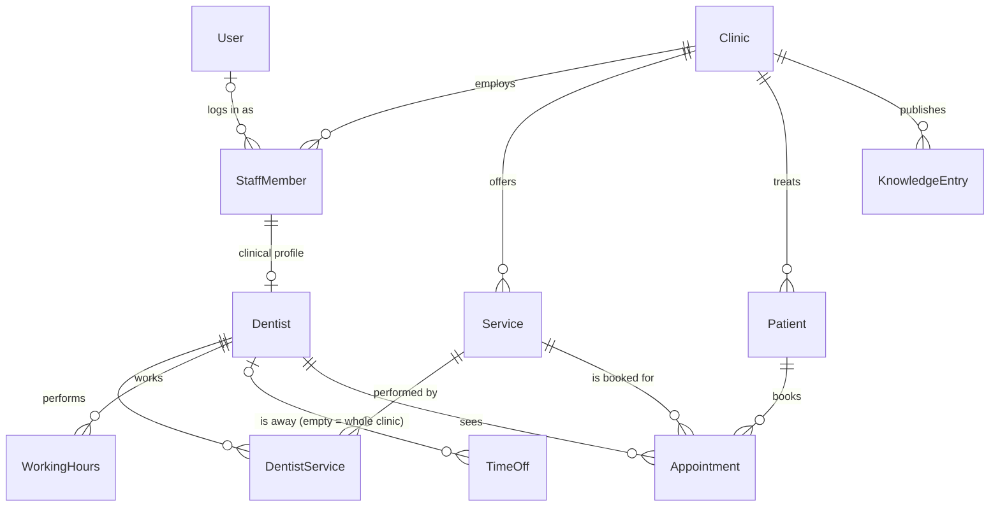

# Architecture

A reusable Dental Clinic SaaS demo. This document describes the system as it
is built today and the decisions behind it. Rules for working on it are in
`PROJECT_RULES.md`.

## 1. System overview

| Layer          | Technology               | Status                       |
| -------------- | ------------------------ | ---------------------------- |
| Backend, admin | Django 5.2 LTS (Python)  | Foundation built (Task 1)    |
| Database       | Supabase PostgreSQL      | Schema and migrations ready  |
| Frontend       | Next.js + TypeScript     | Later phase — not started    |
| AI assistant   | Ollama (local models)    | Later phase — not started    |

Django owns the database schema: all tables are created by Django migrations,
and Django connects to Supabase as a plain PostgreSQL client. Supabase's own
APIs (Data API, Auth, Storage) are not used.

## 2. Repository layout

```
.
├── ARCHITECTURE.md
├── PROJECT_RULES.md
└── backend/
    ├── manage.py
    ├── requirements.txt
    ├── .env.example          # placeholders only; real values in backend/.env
    ├── config/               # settings, URLs, WSGI/ASGI
    ├── apps/
    │   ├── core/             # abstract base models, tenant constraint, admin base
    │   ├── accounts/         # custom User model (admin logins)
    │   ├── clinics/          # Clinic — the tenant
    │   ├── catalog/          # Service — treatments offered
    │   ├── staff/            # StaffMember, Dentist, DentistService
    │   ├── patients/         # Patient
    │   ├── scheduling/       # WorkingHours, TimeOff
    │   ├── appointments/     # Appointment
    │   └── knowledge/        # KnowledgeEntry — curated content for the AI
    └── tests/                # database integrity tests (cross-app)
```

The future frontend will live in `frontend/`.

### App dependencies

Apps only depend downwards (`→` means "depends on"; every app also uses
`core`, which depends on nothing project-specific and refers to
`clinics.Clinic` by string only):

```
clinics      → core
catalog      → clinics
staff        → clinics, catalog, accounts
patients     → clinics
scheduling   → clinics, staff
appointments → clinics, staff, patients, catalog
knowledge    → clinics
```

## 3. Data model

All primary keys are `bigint` identities. All timestamps are `timestamptz`
stored in UTC. Every model except `User` and `Clinic` is clinic-scoped and has
`clinic_id`, `created_at` and `updated_at`.



| Table                      | Purpose                                     | Key rules enforced by PostgreSQL |
| -------------------------- | ------------------------------------------- | -------------------------------- |
| `accounts_user`            | Admin/staff login accounts                  | Django auth defaults |
| `clinics_clinic`           | Tenant: name, slug, contact, time zone, currency | unique `slug` |
| `catalog_service`          | Treatments, duration, optional price        | unique name per clinic; duration 5–480 min; price ≥ 0 |
| `staff_staffmember`        | People working at a clinic, role, optional login | valid role; a login linked once per clinic |
| `staff_dentist`            | Bookable clinical profile of a staff member | one profile per staff member; same clinic as staff member |
| `staff_dentistservice`     | Which dentist performs which service        | unique pair; both in the row's clinic |
| `scheduling_workinghours`  | Weekly recurring availability blocks        | weekday 0–6 (Mon–Sun); end > start; unique block start |
| `scheduling_timeoff`       | Absences; no dentist = clinic-wide closure  | end > start |
| `patients_patient`         | Patient contact data                        | — |
| `appointments_appointment` | Bookings                                    | end > start; valid status/source; **no overlaps**; patient, dentist, service all in the appointment's clinic |
| `knowledge_knowledgeentry` | Curated public content for the AI assistant | unique title per clinic + language; valid category |

Deletion policy: clinics, patients, dentists and services that are referenced
by appointments are protected (`PROTECT`); deactivate them with `is_active` /
`is_bookable` instead. Schedules, time off and dentist–service links are
deleted with their dentist.

## 4. Multi-clinic isolation

Every clinic-scoped row stores `clinic_id`. A plain foreign key cannot stop an
appointment of clinic A from referencing a dentist of clinic B, so each
relation between clinic-scoped models is a **composite foreign key**:

```sql
-- target side
UNIQUE (clinic_id, id)                                   -- e.g. on staff_dentist
-- referencing side
FOREIGN KEY (clinic_id, dentist_id) REFERENCES staff_dentist (clinic_id, id)
```

This is declared in Python with `apps.core.constraints.SameClinicConstraint`,
so Django's migration autodetector tracks it like any built-in constraint,
`manage.py check --database default` (also run before every test run)
verifies its prerequisites, and model validation (admin
forms) reports a field error instead of a database error. The composite key
also makes it impossible to move a record to another clinic while other rows
still reference it.

Adding a new clinic-scoped model:

1. Inherit `ClinicScopedModel`.
2. For each foreign key to another clinic-scoped model, add
   `SameClinicConstraint(field=..., name=...)`.
3. If other models will reference it, add
   `UniqueConstraint(fields=["clinic", "id"], name="<app>_<model>_clinic_key")`.
4. If a migration creates the key and a constraint referencing it, make sure
   the key comes first (see the comment in `staff/migrations/0001_initial.py`).

Tests in `tests/test_clinic_isolation.py` fail if steps 1–2 are forgotten;
the system check (error `core.E003`) stops the test run if step 3 is.

The `clinic_id` column is also the hook for future PostgreSQL Row Level
Security policies and per-clinic admin permissions (not implemented yet; the
admin is currently for platform administrators).

## 5. Appointment overlap prevention

Double booking is prevented by PostgreSQL GiST **exclusion constraints**, so it
holds even for concurrent requests (two bookings racing for the same slot):

```sql
EXCLUDE USING gist (dentist_id WITH =, tstzrange(start_at, end_at, '[)') WITH &&)
    WHERE (status NOT IN ('cancelled', 'no_show'))
EXCLUDE USING gist (patient_id WITH =, tstzrange(start_at, end_at, '[)') WITH &&)
    WHERE (status NOT IN ('cancelled', 'no_show'))
```

- Intervals are half-open `[start, end)`: back-to-back appointments are fine.
- Cancelled and no-show appointments free their slot. Any other status —
  including statuses added in future — blocks it.
- A patient cannot be in two appointments at once, even with different
  dentists.
- The `btree_gist` extension (needed for `dentist_id WITH =`) is created by
  `appointments/migrations/0001_initial.py`.
- Django's model validation runs the same checks, so the admin shows
  "The dentist already has an appointment at this time." instead of an error page.

Deliberately **not** enforced in the database (cross-table rules that belong to
the future booking service): appointments within working hours, outside time
off, and with a dentist who performs the service. Working-hour blocks of one
dentist are checked for overlap by model validation only.

## 6. Time handling

- `USE_TZ = True`; all `DateTimeField`s are stored in UTC (`timestamptz`).
- `Clinic.timezone` (IANA name, validated) defines the local zone in which
  `WorkingHours` times (`time` columns) are interpreted.
- Weekdays use Python's numbering: Monday = 0 … Sunday = 6.

## 7. Configuration

All configuration comes from environment variables (optionally `backend/.env`,
loaded by python-dotenv; real environment variables take precedence).

| Variable                       | Required | Default               | Notes |
| ------------------------------ | -------- | --------------------- | ----- |
| `DJANGO_SECRET_KEY`            | yes      | —                     | long random string |
| `DJANGO_DEBUG`                 | no       | `false`               | `true` only locally |
| `DJANGO_ALLOWED_HOSTS`         | no       | `localhost,127.0.0.1` | comma-separated |
| `DJANGO_CSRF_TRUSTED_ORIGINS`  | no       | empty                 | e.g. `https://admin.example.com` |
| `DJANGO_TIME_ZONE`             | no       | `UTC`                 | admin display zone |
| `DB_NAME`, `DB_USER`, `DB_PASSWORD`, `DB_HOST` | yes | — | PostgreSQL connection |
| `DB_PORT`                      | no       | `5432`                | |
| `DB_SSLMODE`                   | no       | `prefer`              | `require` for Supabase |
| `DB_CONN_MAX_AGE`              | no       | `60`                  | seconds; persistent connections |

## 8. Supabase

- Connect with the **Session pooler** (IPv4, port 5432) or the direct
  connection. The Transaction pooler (port 6543) is not supported by this
  configuration (it would need server-side cursors disabled).
- Use `DB_SSLMODE=require`.
- `btree_gist` is available on Supabase. The migration enables it if it is not
  already enabled; it can also be enabled beforehand in the dashboard
  (Database → Extensions).
- **Data API exposure:** Supabase can expose tables in the `public` schema
  through its auto-generated REST API. Django manages access itself and does
  not use that API, so before storing any real data either disable the Data
  API for the project or remove `public` from its exposed schemas (or enable
  RLS on every table). Never put the Supabase `anon` or `service_role` keys in
  this backend.
- Migrations against the Supabase database require explicit approval (see
  `PROJECT_RULES.md`). Review with `python manage.py sqlmigrate <app> <n>`,
  back up, then `python manage.py migrate`.

Deployment items still open (depend on the hosting choice):
`SECURE_HSTS_SECONDS`, `SECURE_SSL_REDIRECT` / proxy SSL header, static file
serving.

## 9. Testing

- Django's test runner against a local PostgreSQL (`python manage.py test`).
- `backend/tests/` holds the integrity suite: one test per database
  constraint, each asserting the violated constraint's name; tenant-rule
  guards; migration drift check; admin smoke tests.

## 10. Decisions

| Decision | Reason |
| -------- | ------ |
| Django 5.2 LTS rather than 6.x | Long support window (April 2028); upgrade to the next LTS deliberately. |
| psycopg 3, PostgreSQL only | Exclusion constraints and range types are PostgreSQL features; tests must run on the real engine. |
| Custom `User` model from day one | Django cannot easily swap `AUTH_USER_MODEL` after the first migration. |
| `Dentist` as profile of `StaffMember` | One person record; only clinical staff get a bookable profile. |
| `bigint` primary keys | Django default; public-facing identifiers (booking links) will use separate random tokens. |
| Status choices also enforced by `CHECK` | Django does not enforce `choices` in the database. Adding a choice needs a migration — intended. |
| No REST framework, pgvector or Ollama client yet | Not needed in Task 1; added in the phases that use them. |
